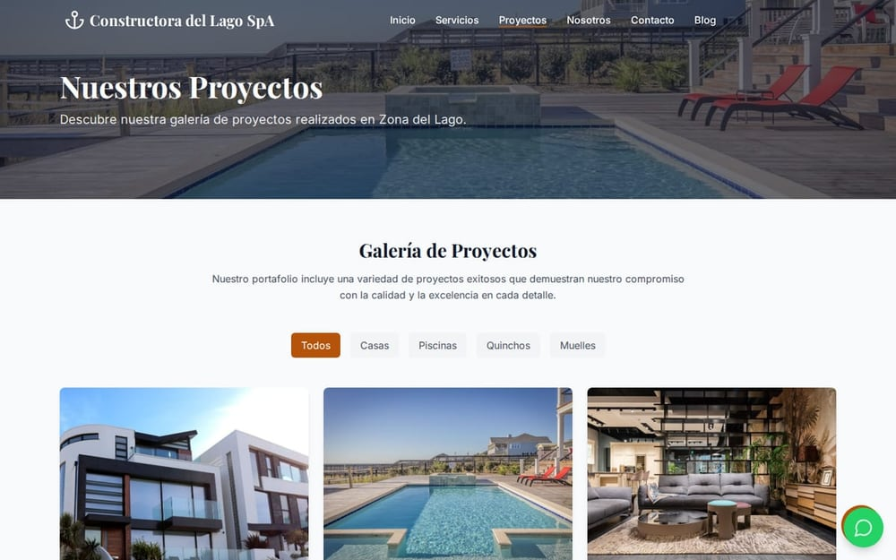
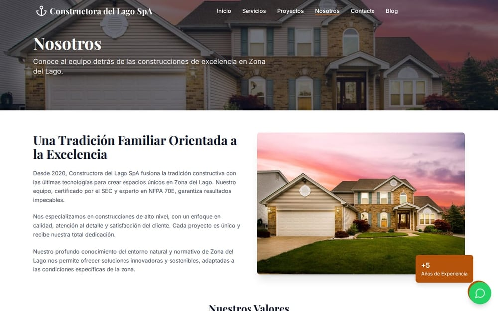
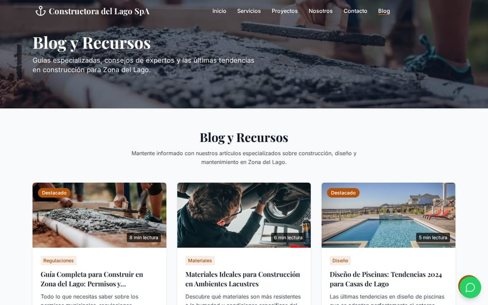
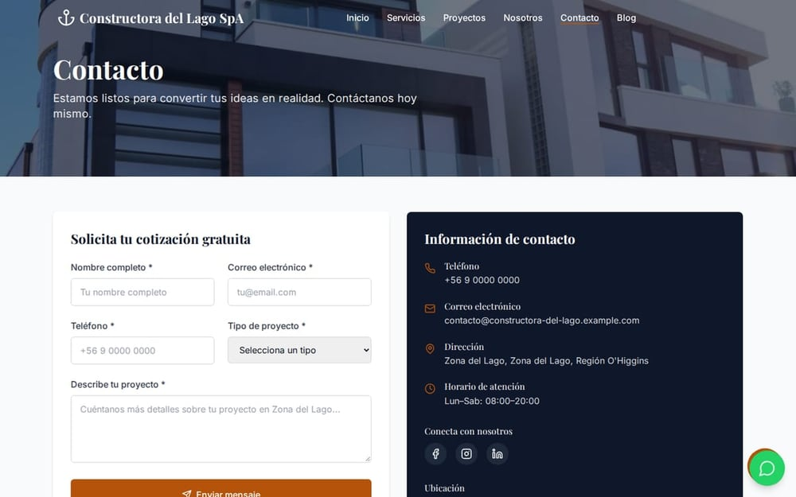
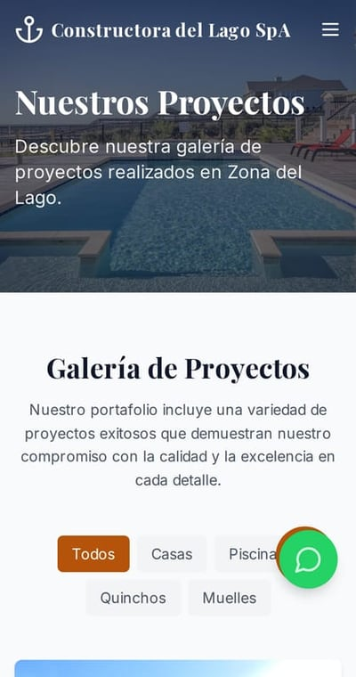

# Constructora del Lago — plataforma web con portal de clientes

> **Escaparate público.** Versión de portafolio de este producto para demostrar diseño,
> arquitectura y flujos. No incluye código fuente, infraestructura ni credenciales.

Plataforma para una constructora en zona lacustre: catálogo de obras, blog técnico, agenda de
visitas, portal privado del cliente, panel de administración y pagos en línea. React + Vite +
TypeScript, bilingüe.

**Versión:** 1.0.0 · **Año:** 2026 · **Estado:** DEVELOPMENT

## Galería

**Escritorio**

|  <b>Portada</b> |  <b>Proyectos</b> |  <b>Detalle de proyecto</b> |
|---|---|---|
|  <b>Nosotros</b> |  <b>Blog</b> |  <b>Citas</b> |
|  <b>Contacto</b> | &nbsp; | &nbsp; |

**Móvil**

|  <b>Móvil · Portada</b> |  <b>Móvil · Proyectos</b> |  <b>Móvil · Contacto</b> |
|---|---|---|

*10 capturas del build real. Cada imagen abre la versión completa; todas están en [`vitrina/screenshots/`](vitrina/screenshots).*

## Documentación

| Documento | Contenido |
|---|---|
| [`vitrina/README.md`](vitrina/README.md) | Presentación, módulos y alcance |
| [`vitrina/docs/ARQUITECTURA.md`](vitrina/docs/ARQUITECTURA.md) | Tres audiencias, proveedores y capas |
| [`vitrina/docs/FUNCIONALIDADES.md`](vitrina/docs/FUNCIONALIDADES.md) | Módulos y para quién existe cada uno |
| [`vitrina/docs/FICHA-TECNICA.md`](vitrina/docs/FICHA-TECNICA.md) | Stack, métricas y defectos corregidos |

## Stack

React · TypeScript · Vite · Tailwind · Supabase · Stripe · i18next · Chart.js · PWA

## Alcance

Es una **vitrina**: demuestra diseño, arquitectura y flujos. No incluye backend activo ni claves de
pago. Los formularios validan y confirman en pantalla; el portal del cliente es navegable en modo
demostración.

Las capturas se generan automáticamente con Playwright desde el build compilado.

## Contacto

Soluciones Industriales Prime JC — [solinprimejc.com](https://solinprimejc.com)
