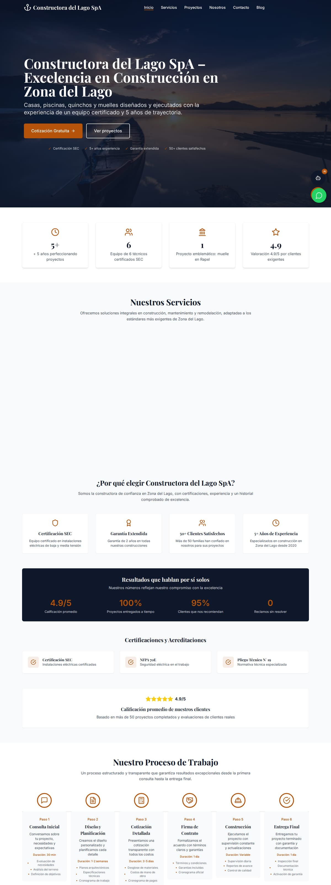
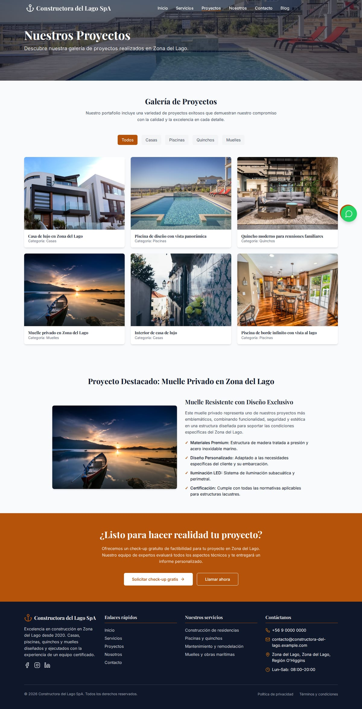
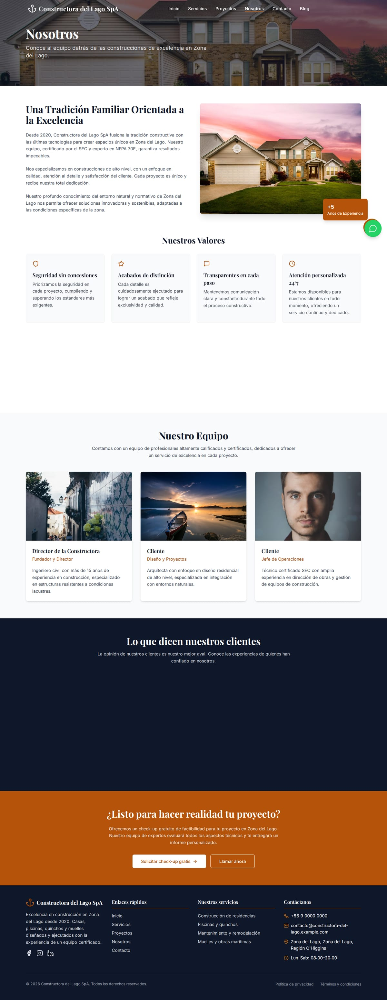
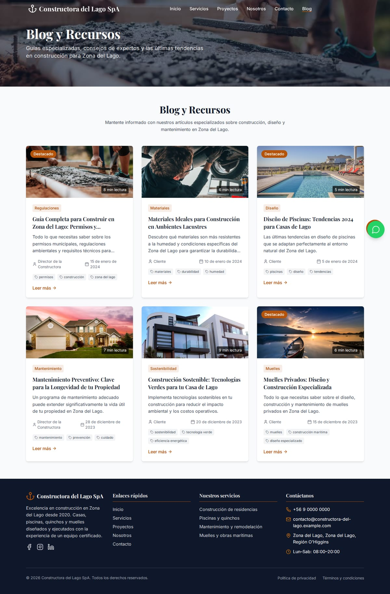
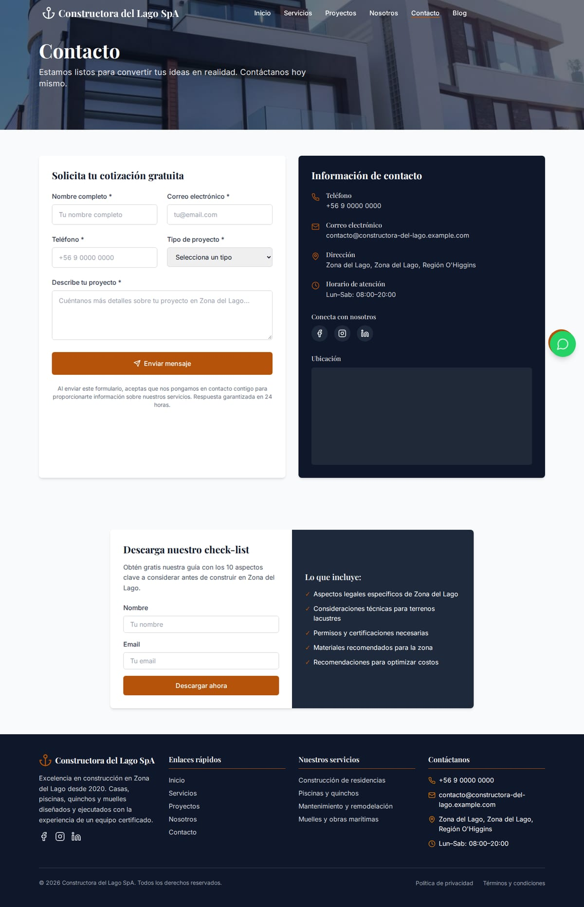
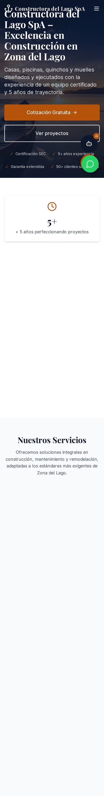
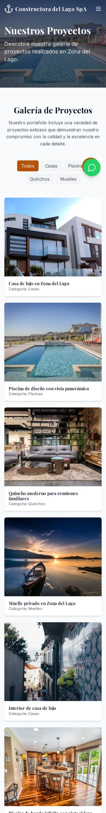
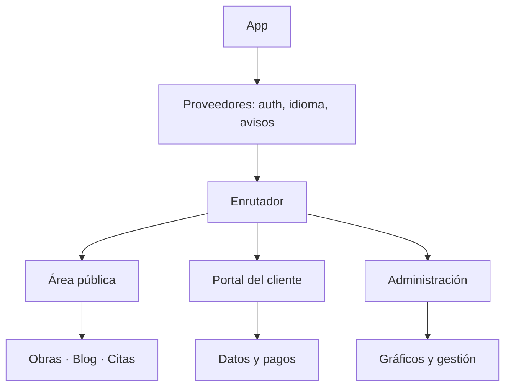

# Constructora del Lago — plataforma web con portal de clientes

> Escaparate de una plataforma para constructora en zona lacustre: catálogo de obras, blog técnico,
> agenda de visitas, portal privado del cliente, panel de administración y pagos en línea.
> React + Vite + TypeScript, bilingüe.

| | |
|---|---|
| **Tipo** | Plataforma web con área pública, portal de cliente y administración |
| **Stack** | React 18 · Vite · TypeScript · Tailwind · Supabase · Stripe |
| **Páginas** | 12 rutas (públicas, autenticadas y administrativas) |
| **Estado** | Escaparate funcional: compila, renderiza y navega sin backend |
| **Alcance** | Demostración. Pagos, datos y correo en modo simulado |

## Qué resuelve

Una constructora pequeña vende por teléfono y pierde el hilo de cada obra. Este sitio le da tres
cosas que un folleto no tiene:

1. **Captación** → obras ejecutadas, servicios, blog técnico y agenda de visitas.
2. **Confianza** → fichas de proyecto con fotos, plazos, materiales y resultados.
3. **Continuidad** → el cliente entra a su portal y ve el estado de su obra, sus pagos y sus citas.

## Capturas

### Portada

### Proyectos

### Detalle de proyecto

### Nosotros

### Blog

### Agenda de visitas

### Contacto

### Móvil
| Portada | Proyectos | Contacto |
|---|---|---|
|  |  |  |

## Módulos

| Módulo | Para qué existe |
|---|---|
| **Catálogo de obras** | fichas con tipo, superficie, plazo, materiales y galería |
| **Blog técnico** | contenido en Markdown para posicionar y educar |
| **Agenda de visitas** | selección de fecha y hora con validación |
| **Portal del cliente** | estado de la obra, documentos, pagos y citas |
| **Panel de administración** | gestión de proyectos, clientes y métricas con gráficos |
| **Pagos** | cobro preparado para Stripe (modo demostración) |
| **Autenticación** | registro, acceso, recuperación y perfil |
| **Bilingüe** | interfaz en español e inglés con detección de idioma |
| **Analítica** | medición de navegación y eventos de conversión |
| **PWA** | instalable y con soporte sin conexión |

## Cómo está construido

- **Tres audiencias en un solo producto**: visitante, cliente y administrador. Cada una tiene su
  propio conjunto de rutas y su propia navegación.
- **Contenido separado de la vista**: obras, servicios y artículos viven como datos tipados.
- **Idioma como proveedor**: la traducción se resuelve una vez arriba del árbol, no por componente.

Detalle en [`docs/ARQUITECTURA.md`](docs/ARQUITECTURA.md),
[`docs/FUNCIONALIDADES.md`](docs/FUNCIONALIDADES.md) y
[`docs/FICHA-TECNICA.md`](docs/FICHA-TECNICA.md).

## Alcance de esta versión

Es una **vitrina**: demuestra diseño, arquitectura y flujos. No incluye backend activo ni claves de
pago. Los formularios validan y confirman; el portal es navegable en modo demostración.

## Créditos de imágenes

Fotografías de **Pexels**, bajo su [licencia libre](https://www.pexels.com/license/), usadas como
material de demostración.

## Contacto

Soluciones Industriales Prime JC — [solinprimejc.com](https://solinprimejc.com)
